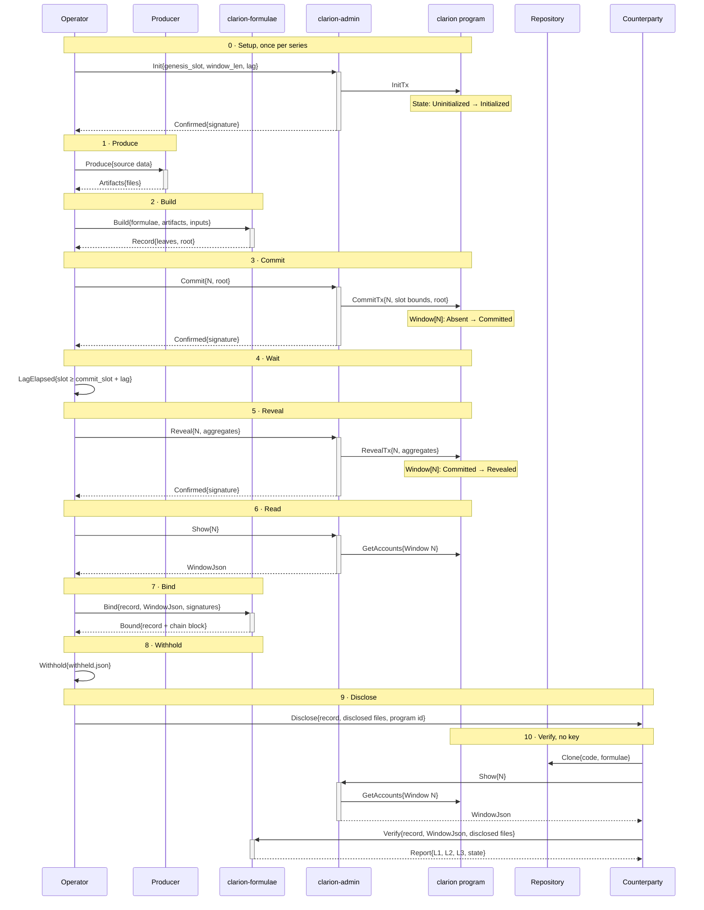

# aetelier-clarion

<br>

[![Build][badge-build]][url-build]
[![Rust][badge-rust]][url-rust]
[![MIT licensed][badge-license]][url-license]

[badge-build]: https://github.com/aetelierxyz/aetelier-clarion/actions/workflows/ci.yml/badge.svg
[url-build]: https://github.com/aetelierxyz/aetelier-clarion/actions/workflows/ci.yml
[badge-rust]: https://img.shields.io/badge/rust-1.99%2B-orange.svg?maxAge=3600
[url-rust]: https://github.com/aetelierxyz/aetelier-clarion
[badge-license]: https://img.shields.io/badge/license-MIT-blue
[url-license]: LICENSE

<br>

Any dataset can be viewed as a claim of knowledge. The results of a backtest, the transactions on a market, the state of a trading system. We do have a public layer, but we sacrificed compute for speed. Heavy workloads and data intensive representations are economically unfeasible. 

Why not Off-Chain compute with On-Chain attestation and Off-chain validation. The balancing act is an economic model, who does what and how much it gains, and why a service for this instead plain OnChain publications, or even, why not just trusting ?.

Aetelier-Clarion is the module that takes a dataset, presents a formulae as the validity structure, and generates the on chain attestation, so a third party can do an off-chain validation as well.

# How it works



## Actors & Notes

| Actor | Class | Phases | Role |
|---|---|---|---|
| Operator | Human | 0–9 | Holds the authority key; runs each step and carries values between them |
| Producer | Ephemeral | 1 | Writes the artifacts to attest; outside clarion, its output is taken as given |
| clarion-formulae | Ephemeral | 2, 7, 10 | Builds a record from artifacts per a formulae document, binds it to its window, verifies it offline |
| clarion-admin | Ephemeral | 0, 3, 5, 6, 10 | Signs and sends `Init`, `Commit` and `Reveal`; reads windows over RPC |
| clarion program | Persistent | 0, 3, 5, 6, 10 | Stores one root per window; enforces authority, order, reveal lag and sequence |
| Repository | Store | 10 | Holds the code, the formulae documents and the demo records |
| Counterparty | Human | 9, 10 | Receives a record with its disclosed files and verifies it against the chain, without a key |

- Each participant is an actor with private state that handles one message at a time.
- Messages are `Name{payload}`; dashed arrows are replies.
- Bars mark a running CLI process; notes over the clarion program mark on-chain account state.
- Self messages are a timer (`LagElapsed`) or a local action (`Withhold`).
- Numbers are phases 0–10.

## Demo

The demo series attests a synthetic record: fake symbols and invented parameters. Verify its window 0 against devnet:

```sh
cargo build --release --workspace
D=attestations/devnet/BjLoUKJ48wxVZXPEuR5JSmuXSkC5YqBvtN5i2cT51y3e/0
target/release/clarion-admin --rpc-url https://api.devnet.solana.com --program-id BjLoUKJ48wxVZXPEuR5JSmuXSkC5YqBvtN5i2cT51y3e show --window-id 0 > show.json
target/release/clarion-formulae verify --attestation $D/attestation.json --window show.json --artifacts $D
```

Expected output, exit 0:

```text
layer 1 formulae: pass
layer 2 chain: pass
layer 3 artifacts: pass
state: Revealed
```

## How to use: attest one tracer run

Own devnet series; records private by default. **operator**: authority key; **private**: outside this repository; **counterparty**: gets the record.

**Assumptions** (outside clarion)
- `programs/clarion` on devnet; private `program.json`, funded `authority.json`; Solana CLI, `jq`.
- `DIR`, private: tracer replay at `TRACER_SHA`:
  - `corrected_ledger.json`: paper trades minus unfilled maker orders; counts, USD total, input hashes.
  - `fillrates.json`: fill rates per symbol and delay.
  - `tracer_params.v1.json`: frozen study parameters.

```sh
cargo build --release --workspace
PID=$(solana-keygen pubkey program.json)
C="target/release/clarion-admin --rpc-url https://api.devnet.solana.com --program-id $PID"
K="--authority authority.json"
F=target/release/clarion-formulae
OUT=disclosure
Z='"tx_submitted":0,"tx_landed":0,"stl_p50_slots":0,"stl_p90_slots":0,"cu_price_p50_micro":0,"cu_price_p90_micro":0,"fee_total_lamports":0,"tip_total_lamports":0'
ARMS="[{\"arm\":\"fan_out\",$Z},{\"arm\":\"tip_lane\",$Z},{\"arm\":\"rpc_default\",$Z},{\"arm\":\"fixed_priority_fee\",$Z}]"
```

**0 · Setup**, operator. State: Uninitialized → Initialized; `show-authority` prints your key.

```sh
G=$(( $(solana slot -u devnet) + 150 ))
$C $K init --genesis-slot $G --window-len 150 --lag 150 --program-keypair program.json
$C show-authority
```

**1 · Produce**, private, assumed.

**2 · Build**, operator. Record: Built; field values in plain form.

```sh
$F build --formulae formulae/trace-completed.v1.json --artifacts DIR --input system.source_commit=TRACER_SHA --input results.subject_id=replay --out DIR/attestation.json
ROOT=$(jq -r .root DIR/attestation.json)
```

**3 · Commit**, operator. Window[0]: Absent → Committed; `show`: your root, `reveal_slot` 0.

```sh
until [ $(solana slot -u devnet) -gt $((G + 149)) ]; do sleep 5; done
CS=$($C $K commit --window-id 0 --root $ROOT)
$C show --window-id 0
```

**4 · Wait**, operator, 150 slots; early reveals fail: `RevealLagNotElapsed`.

```sh
CSL=$($C show --window-id 0 | jq .commit_slot)
until [ $(solana slot -u devnet) -ge $((CSL + 150)) ]; do sleep 5; done
```

**5 · Reveal**, operator. Window[0]: Committed → Revealed; `reveal_slot` > 0.

```sh
RS=$($C $K reveal --window-id 0 --aggregates "$ARMS")
```

**6 · Read, 7 · Bind**, operator. Chain block added; full verify passes.

```sh
$C show --window-id 0 > show.json
$F bind --attestation DIR/attestation.json --window show.json --cluster devnet --program-id $PID --commit-signature $CS --reveal-signature $RS
$F verify --attestation DIR/attestation.json --window show.json --artifacts DIR
```

**8 · Withhold**, operator, optional: calibration private, hash declared.

```sh
mkdir -p $OUT
cp DIR/attestation.json DIR/corrected_ledger.json DIR/fillrates.json $OUT/
printf '{"filename":"tracer_params.v1.json","sha256":"%s"}\n' $(shasum -a 256 DIR/tracer_params.v1.json | cut -d' ' -f1) | jq -s '{schema: "formulae.withheld.v1", files: .}' > $OUT/withheld.json
```

**9 · Disclose**, operator. `$OUT` and the program id to the counterparty; a public pull request is optional.

```sh
tar -czf $OUT.tgz $OUT
```

**10 · Verify**, counterparty. Layers 1–2 pass, 3 partial; `Revealed`, exit 0.

```sh
$C show --window-id 0 > show.json
$F verify --attestation $OUT/attestation.json --window show.json --artifacts $OUT
```

## Devnet

| Item | Demo series |
|---|---|
| Program id | `BjLoUKJ48wxVZXPEuR5JSmuXSkC5YqBvtN5i2cT51y3e` |
| Upgrade authority | `52vSvudaMcyj2oMpqDcr6ijsis1MZDLRn5rJ4X2C7BBu` |
| State account | `9fY8aqwyYJbv55rqmtduVyptBCmVGhTbSGP9dZPvBDmb` |
| Genesis slot | `518802837` |
| Window length | 150 slots |
| Minimum reveal lag | 150 slots |
| Executable hash | `79a0f04ece0675f7e9859faa1833b0341b113376552fbb743d4510aee8e8debb` |

## Verifiable build

`programs/clarion` builds in the digest-pinned `solanafoundation/solana-verifiable-build:3.1.13` image, selected by `[workspace.metadata.cli]` in its `Cargo.toml`:

```sh
solana-verify build "$PWD/programs/clarion"
solana-verify get-executable-hash programs/clarion/target/deploy/clarion.so
solana-verify --url https://api.devnet.solana.com get-program-hash <program id>
```

Equal hashes mean the deployed program was built from the checked-out commit.

CI runs the same comparison against the demo program on every push and pull request, with `.github/scripts/demo-drift-check.sh` and the repository variable `CLARION_DEMO_PROGRAM_ID`. A difference fails pushes to `main` and tags; on pull requests it is reported, because the deployed program changes only after an announced upgrade.
